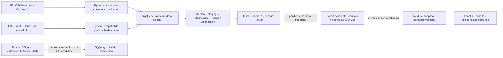

# Vaca Muerta en Datos

**Un producto analítico para entender cómo evoluciona la producción no convencional de Vaca Muerta, quién la impulsa y dónde se concentra.** Convierte declaraciones mensuales oficiales en métricas comparables, rankings y exploración interactiva, con trazabilidad desde la fuente hasta la pantalla.

Está pensado para analistas, equipos de energía, periodistas y personas que necesitan responder preguntas de negocio sin recorrer archivos anuales ni escribir SQL. Como portfolio, demuestra un recorrido completo de ingeniería de datos, modelado analítico y diseño de producto.

> **Estado de esta entrega:** versión de revisión local, sin promoción ni despliegue automático. El snapshot candidato acepta producción hasta **agosto de 2026**; septiembre parcial se excluye. “Preliminar” indica que falta aprobación de publicación, aunque el snapshot tenga validación técnica. Los datos oficiales pueden rectificarse.

La [revisión integrada de las cinco vistas](docs/evidence/integrated/README.md) reúne capturas desktop/mobile, resultados de 47 tests y límites explícitos de la validación. La [auditoría del snapshot y los precios](docs/evidence/data-valuation/README.md) permite recorrer la trazabilidad de datos.

## Qué preguntas responde

| Vista | Pregunta | Evidencia que ofrece |
| --- | --- | --- |
| **Resumen** | ¿Cuál es el nivel actual y qué cambió? | Tasa diaria equivalente, volumen mensual, pozos productivos, evolución y concentración |
| **Producción** | ¿Cómo evoluciona petróleo o gas frente al mes anterior, al año anterior y al acumulado comparable? | Series históricas, comparación entre años, cambio absoluto y tabla descargable |
| **Operadores** | ¿Quién produce y cómo cambia su participación? | Ranking completo, filtros y evolución por operador |
| **Áreas** | ¿Dónde se concentra la producción y cómo evoluciona cada permiso o concesión? | Ranking, detalle temporal y relación operador–área sólo con respaldo de datos |
| **Actividad** | ¿Cómo evoluciona la cantidad de pozos con producción y su producción media? | Pozos productivos históricos y promedio por pozo y día calendario; las definiciones limitan qué dinámica puede inferirse |

Las vistas comparten producto, período, volumen/valor, comparación mensual/interanual, ES/EN, tema claro/oscuro y navegación por URL. El mismo componente de KPI, card o gráfico mantiene la misma jerarquía visual. Petróleo usa azul, gas violeta, valor monetario ámbar; las variaciones positivas y negativas mantienen verde y rojo por convención del producto.

## Datos y límites de interpretación

La fuente principal es [Capítulo IV de la Secretaría de Energía](https://datos.gob.ar/dataset/energia-produccion-petroleo-gas-por-pozo-capitulo-iv). El universo es **formación Vaca Muerta + recurso no convencional**: no representa toda la Cuenca Neuquina ni toda la producción argentina.

- **Petróleo:** m³ × 6,28981077 = barriles. **Gas:** miles de m³ convertidos a MMm³. Tasa diaria equivalente = volumen mensual / días calendario.
- **Pozos productivos:** pozos únicos con producción positiva del fluido elegido en cada mes. Un pozo puede producir ambos fluidos; los conteos no se suman.
- **Valor USD de petróleo:** barriles × promedio mensual Brent de [EIA](https://www.eia.gov/dnav/pet/hist/leafhandler.ashx?f=m&n=pet&s=rbrte) del mismo mes. Es una estimación bruta de referencia, no ingresos realizados, margen ni beneficio. Sin precio válido se muestra indisponibilidad.
- **Valor USD de gas:** referencia internacional **Henry Hub mensual de EIA**, del mismo mes. Volumen m³ × equivalencia energética de referencia × USD/MMBtu. La equivalencia es el escenario fijo EIA de 1.036 BTU/pie³ (promedio estadounidense estimado 2026), **no el poder calorífico medido de Vaca Muerta**. El selector Gas USD muestra valor estimado y explicita el supuesto; no representa ingresos realizados. Sin precio válido → indisponibilidad. Ver [contrato y metodología](specs/017-international-gas-reference.md).

- **Actividad:** producción media por pozo y día calendario no equivale a productividad por día efectivo de operación. No se infieren altas, bajas, perforación o completaciones a partir de un conteo agregado.
- **Frecuencia:** datos mensuales, sin telemetría ni contador en tiempo real. Las transferencias de activos y rectificativas pueden alterar comparaciones por entidad.

La [auditoría del snapshot y la valorización](docs/evidence/data-valuation/README.md) documenta corte, cobertura, fuentes, fechas y conciliación. El [modelo de datos](specs/001-vaca-muerta-pulse/data-model.md) explicita granos y unidades.

## Arquitectura y decisiones



| Capa | Tecnología actual | Por qué se eligió |
| --- | --- | --- |
| Extracción candidata | CLI Python sobre CSV oficial anual y HTML EIA; Meltano/Singer se conserva para la ruta histórica CKAN | CSV comprobado más completo que DataStore; contratos, snapshots y hashes reproducibles sin trasladar reglas al browser |
| Warehouse | BigQuery con particiones y clustering | Consulta analítica sin administrar servidores; control de bytes escaneados y separación dev/candidato/prod |
| Transformación | dbt Core, SQL, tests y seeds | Granos explícitos, conversiones únicas, conciliación y contratos revisables |
| Publicación de datos | Agregados JSON, manifiestos y SHA-256 | El browser no necesita credenciales; recibe un snapshot consistente y verificable; promoción separada de construcción |
| Aplicación | Next.js 16, React 19 y TypeScript 7 | Componentes tipados, navegación persistente y exportación estática |
| Visualización | Recharts 3 y componentes propios con CSS compartido | Una línea creativa y semántica común, con control de accesibilidad y responsive |
| Verificación | Node test runner, Playwright y axe; tests dbt y conciliación Python | Comprobar cálculos, contratos, navegación y presentación en varias pantallas |
| Automatización | CLI compartido Python y GitHub Actions con WIF | Mismos controles localmente y en runner; permisos separados por etapa, sin claves permanentes; activación pendiente |

La UI usa Recharts y componentes comunes, documentados en [ADR 0003](docs/adrs/0003-resumen-ui.md). Para el detalle y los compromisos de diseño: [arquitectura](docs/architecture.md), [ADRs](docs/adrs/README.md).

## Linaje generado desde dbt


El grafo deriva del manifest dbt retenido y está contrastado con el SQL presente: **11 modelos, 2 fuentes y 11 dependencias**. Se publica una vista depurada sin tests/macros ni metadatos de conexión. [Procedencia y alcance](docs/lineage/README.md). Es un diagrama retenido; no incluye la nueva capa de precios. El [linaje del candidato ejecutado](docs/evidence/orchestration/linaje-candidato.md), generado del manifest real, muestra el recorrido probado de producción y valorización. Ninguno representa aún la publicación histórica completa del dashboard.

## Precios: implementación candidata y consumidor actual

La capa candidata ya implementa **fuente dinámica → raw BigQuery → dbt → valorización**. El 12 de octubre se descargó Brent oficial nuevamente, se verificó su hash y se cargaron 472 meses hasta agosto de 2026 en `raw_cap4_candidate_dev.monthly_reference_price`. Agosto: 91,08 USD/bbl. dbt construye valor bruto de referencia por pozo y entidad, comparaciones contra meses calendario y YTD únicamente si está completo; precios o volúmenes inválidos quedan NULL. No son ingresos realizados. Ver [contrato de precios](specs/016-candidate-pricing.md) y [revalidación oficial](docs/pricing/revalidation-2026-10-12.md).

**El frontend todavía usa el snapshot de revisión anterior y calcula la valorización en TypeScript.** No hace llamadas a EIA. Migrar su consumo al mart validado y exportar historia multianual pertenece al cierre integrado, aún pendiente. Las cotizaciones revisables no se mantienen como seeds permanentes: los seeds se reservan para catálogos y supuestos estables. Gas USD usa Henry Hub con escenario energético EIA documentado; sin forward fill ni sustitutos silenciosos.

## Orquestación, extracción y freshness

El [CLI compartido](pipeline/CLI.md) ejecuta las mismas etapas localmente y en GitHub: descarga/revisión → cargas candidatas → gates de raw y linaje → dbt parse/compile/build/tests. El workflow está preparado, **`DATA_PIPELINE_ENABLED=false`**, y todavía no se comprobó desde un runner real. El calendario previsto es día 5 de cada mes a las **03:00 de Argentina**; no demuestra que la fuente publique ese día.

| Etapa | Implementación actual | Límite operativo |
| --- | --- | --- |
| Fuente de producción | CSV estándar oficial 2026; 663.748 filas descargadas, SHA-256 y esquema revisados | Contrato fijo 2026/agosto; no selecciona el último mes automáticamente. DataStore no reproduce agosto |
| Cobertura | 16 conciliaciones enero–agosto × petróleo/gas contra el snapshot revisado | Septiembre parcial queda excluido. Esto no constituye aprobación de publicación |
| Carga | `WRITE_TRUNCATE` atómico por tabla aislada; identidad/hash por fila y recibo de job | No reemplaza el histórico compartido. Producción y precio son cargas separadas, no una transacción conjunta |
| Transformación | dbt con producción, dimensiones y precios seleccionados; datasets staging/intermediate/marts candidatos | Build real aprobado: 88 nodos con Brent y Henry Hub sin errores, warnings ni skips; candidato sólo agosto, sin completaciones ni publicación multianual |
| Freshness y linaje | Extracción e ingesta ≤7 días, cronología, conteos, SHA/corte y unidades revalidados antes de dbt | Frescura de carga no equivale a frescura económica. No se verifica cada valor de warehouse contra bytes CSV sólo por comprobar SHA declarado |
| Acceso | WIF configurado y cuentas separadas de extracción/dbt, permisos por dataset | Sin claves nuevas ni secretos públicos. Falta prueba desde GitHub; no se habilitó facturación |
| Frontend y promoción | Snapshot anterior conservado; no export ni deploy desde el CLI | Cierre integrado y publicación requieren revisión y aprobación independientes |

Cada consulta tiene presupuesto máximo de **1 GiB**, la descarga máximo 1 GiB y la fuente máximo dos millones de filas; esos límites no son una estimación de costo total. La evidencia de GitHub conserva siete días sólo JSON reducido: no sube raw, perfiles, credenciales ni logs completos dbt. Un error, skip o warning dbt impide aceptar el resultado de transformación. Una anomalía microscópica fuera de Vaca Muerta, dentro de `[-1e-12, 0)`, se preserva como advertencia; cualquier negativo en el universo de producto falla.

El portal oficial redirige CSV/API a HTTP público. Se restringen host/ruta/recurso y no se envían credenciales; el hash demuestra identidad de bytes retenidos, no autenticidad criptográfica del transporte. Ver [evidencia de fuente](docs/evidence/source-candidate/README.md), [decisión del pipeline](docs/adrs/0006-candidate-pipeline.md) y [gates](specs/015-dev-pipeline-gates.md).

**Validación real comprobada:** el CLI compartido `all` pasó sus 12 etapas, desde descarga/carga de producción y precios hasta transformación en BigQuery; dbt completó 83 nodos (8 tablas, 3 vistas, 66 tests de datos y 6 unit tests), sin errores, warnings ni skips. Las conciliaciones también pasaron y hay 75 pruebas offline aprobadas. El recorrido completo de extracción y transformación se repitió en una sola ejecución real y pasó. Ver [evidencia de orquestación](docs/evidence/orchestration/README.md).

**Lo pendiente:** comprobar WIF y el mismo recorrido desde un runner de GitHub, integrar historia/fluido y exportadores, conectar el frontend al candidato validado y realizar el cierre visual/documental. No se mergeó, activó ni desplegó esta automatización.

## Ejecutar la aplicación

Requisitos: Node.js 22.13+ y npm; las credenciales de GCP sólo son necesarias para ejecutar las capas de datos, no para ver el snapshot de revisión.

```sh
cd apps/web
npm ci
npm run dev
```

Abrir `http://localhost:3000/vaca-muerta-pulse/`.

```sh
npm run typecheck
npm test
npm run build
npm run test:browser
```

El runner de navegador requiere Chromium instalado (`npx playwright install chromium`). Los comandos y reportes históricos no equivalen a resultados de la integración actual: la entrega final debe adjuntar su propia evidencia. Guías específicas: [frontend](apps/web/README.md), [extracción](extraction/README.md), [transformación](transform/README.md).

## Recorrer el repositorio

| Directorio | Responsabilidad |
| --- | --- |
| `apps/web/` | Aplicación, componentes, cálculos de presentación, contrato y tests |
| `extraction/` | Taps, recursos, contratos y preparación de cargas |
| `transform/` | Modelos dbt, tests, seeds y operación del warehouse |
| `scripts/` | Importación de Brent y vínculo de artefactos |
| `specs/` | Preguntas, alcance, definiciones y criterios de aceptación |
| `docs/adrs/` | Decisiones de arquitectura y sus motivos |
| `docs/evidence/` | Capturas, auditorías y resultados con alcance y limitaciones |
| `apps/spike/` | Exploración histórica; no forma parte del frontend final |

El identificador del repositorio sigue siendo [`vaca-muerta-pulse`](https://github.com/nrohland/vaca-muerta-pulse); el nombre de producto es **Vaca Muerta en Datos**.

## Desarrollo y revisión

El proyecto usa especificaciones y ADRs para registrar cambios de fuente, grano, métricas o arquitectura. Los roles separan Data Engineering (extracción/warehouse), Analytics Engineering (modelado y calidad), frontend (producto) y QA (aceptación). [AGENTS.md](AGENTS.md) contiene las reglas de contribución.

Nunca se versionan secretos ni dumps raw pesados. Los cambios se revisan en ramas/PR; agentes no mergean, publican ni despliegan sin autorización. La promoción de un candidato y el cierre operativo del pipeline son pasos explícitos de aceptación.

### Pipeline candidato en validación

Acceso federado autorizado, aplicado y verificado el 12 de octubre de 2026; automatización todavía desactivada. Producción y Brent ya se cargaron en raw candidato aislado y la fase real de transformación pasó con 83 nodos dbt aprobados. Ver [CLI compartido](pipeline/CLI.md) y [evidencia de permisos y tamaño del raw](docs/evidence/pipeline-access/README.md). Esta etapa no cambia el snapshot de la aplicación ni constituye aún el pipeline multianual de publicación.

### Referencia de gas definida

La referencia activa de gas es Henry Hub internacional. Se ingieren 356 meses hasta agosto, junto con 472 de Brent, con metadatos y hashes por fuente. La equivalencia energética es un supuesto versionado EIA, explicitado en la UI; no una medición de gas argentino. [Metodología](specs/017-international-gas-reference.md). La evidencia anterior de gas indisponible corresponde a la fase previa a esta decisión.

Validación posterior con gas: 88 nodos dbt (11 modelos, 67 tests de datos, 10 unit tests), conciliación independiente y paridad del total de agosto con la UI. [Resultados y capturas](docs/evidence/gas-reference/README.md).
