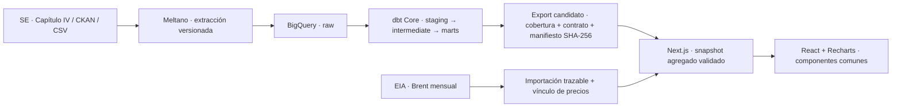

# Vaca Muerta en Datos

**Un producto analítico para entender cómo evoluciona la producción no convencional de Vaca Muerta, quién la impulsa y dónde se concentra.** Convierte declaraciones mensuales oficiales en métricas comparables, rankings y exploración interactiva, con trazabilidad desde la fuente hasta la pantalla.

Está pensado para analistas, equipos de energía, periodistas y personas que necesitan responder preguntas de negocio sin recorrer archivos anuales ni escribir SQL. Como portfolio, demuestra un recorrido completo de ingeniería de datos, modelado analítico y diseño de producto.

> **Estado de esta entrega:** versión de revisión local, sin promoción ni despliegue automático. El snapshot candidato acepta producción hasta **agosto de 2026**; septiembre parcial se excluye. “Preliminar” indica que falta aprobación de publicación, aunque el snapshot tenga validación técnica. Los datos oficiales pueden rectificarse.

La [revisión integrada de las cinco vistas](docs/evidence/integrated/README.md) reúne capturas desktop/mobile, resultados de 43 tests y límites explícitos de la validación. La [auditoría del snapshot y los precios](docs/evidence/data-valuation/README.md) permite recorrer la trazabilidad de datos.

## Qué preguntas responde

| Vista | Pregunta | Evidencia que ofrece |
| --- | --- | --- |
| **Resumen** | ¿Cuál es el nivel actual y qué cambió? | Tasa diaria equivalente, volumen mensual, pozos productivos, evolución y concentración |
| **Producción** | ¿Cómo evoluciona petróleo o gas frente al mes anterior, al año anterior y al acumulado comparable? | Series históricas, comparación entre años, cambio absoluto y tabla descargable |
| **Operadores** | ¿Quién produce y cómo cambia su participación? | Ranking completo, filtros y evolución por operador |
| **Áreas** | ¿Dónde se concentra la producción y cómo evoluciona cada permiso o concesión? | Ranking, detalle temporal y relación operador–área sólo con respaldo de datos |
| **Actividad** | ¿Cómo evoluciona la cantidad de pozos con producción y su producción media? | Pozos productivos históricos y promedio por pozo y día calendario; las definiciones limitan qué dinámica puede inferirse |

Las vistas comparten producto, período, volumen/valor, comparación mensual/interanual, ES/EN, tema claro/oscuro y navegación por URL. El mismo componente de KPI, card o gráfico mantiene la misma jerarquía visual. Petróleo usa azul, gas violeta, valor monetario ámbar; las variaciones positivas y negativas mantienen verde y rojo por convención del producto.

## Datos y límites de interpretación

La fuente principal es [Capítulo IV de la Secretaría de Energía](https://datos.gob.ar/dataset/energia-produccion-petroleo-gas-por-pozo-capitulo-iv). El universo es **formación Vaca Muerta + recurso no convencional**: no representa toda la Cuenca Neuquina ni toda la producción argentina.

- **Petróleo:** m³ × 6,28981077 = barriles. **Gas:** miles de m³ convertidos a MMm³. Tasa diaria equivalente = volumen mensual / días calendario.
- **Pozos productivos:** pozos únicos con producción positiva del fluido elegido en cada mes. Un pozo puede producir ambos fluidos; los conteos no se suman.
- **Valor USD de petróleo:** barriles × promedio mensual Brent de [EIA](https://www.eia.gov/dnav/pet/hist/leafhandler.ashx?f=m&n=pet&s=rbrte) del mismo mes. Es una estimación bruta de referencia, no ingresos realizados, margen ni beneficio. Sin precio válido se muestra indisponibilidad.
- **Gas en USD:** pendiente de referencia y conversión energética válidas; no se sustituye con Brent o un precio supuesto.
- **Actividad:** producción media por pozo y día calendario no equivale a productividad por día efectivo de operación. No se infieren altas, bajas, perforación o completaciones a partir de un conteo agregado.
- **Frecuencia:** datos mensuales, sin telemetría ni contador en tiempo real. Las transferencias de activos y rectificativas pueden alterar comparaciones por entidad.

La [auditoría del snapshot y la valorización](docs/evidence/data-valuation/README.md) documenta corte, cobertura, fuentes, fechas y conciliación. El [modelo de datos](specs/001-vaca-muerta-pulse/data-model.md) explicita granos y unidades.

## Arquitectura y decisiones



| Capa | Tecnología actual | Por qué se eligió |
| --- | --- | --- |
| Extracción | Python, Meltano y Singer; tap CKAN propio | Configuración y cargas reproducibles en Git; separación entre extracción y reglas de negocio |
| Warehouse | BigQuery con particiones y clustering | Consulta analítica sin administrar servidores; control de bytes escaneados y separación dev/candidato/prod |
| Transformación | dbt Core, SQL, tests y seeds | Granos explícitos, conversiones únicas, conciliación y contratos revisables |
| Publicación de datos | Agregados JSON, manifiestos y SHA-256 | El browser no necesita credenciales; recibe un snapshot consistente y verificable; promoción separada de construcción |
| Aplicación | Next.js 16, React 19 y TypeScript 7 | Componentes tipados, navegación persistente y exportación estática |
| Visualización | Recharts 3 y componentes propios con CSS compartido | Una línea creativa y semántica común, con control de accesibilidad y responsive |
| Verificación | Node test runner, Playwright y axe; tests dbt y conciliación Python | Comprobar cálculos, contratos, navegación y presentación en varias pantallas |
| Automatización | GitHub Actions | Ejecución versionada de extracción y validación de configuración; el pipeline completo aún requiere coordinación explícita |

Tremor fue una decisión inicial de planificación; **no es una dependencia del frontend actual**. La revisión UI usa Recharts y componentes comunes, documentados en [ADR 0003](docs/adrs/0003-resumen-ui.md). Para el detalle y los compromisos de diseño: [arquitectura](docs/architecture.md), [ADRs](docs/adrs/README.md).

## Orquestación, extracción y freshness

Hoy hay piezas reproducibles, pero **no se presenta como un pipeline de producción automatizado de punta a punta**.

| Etapa | Implementación actual | Límite operativo |
| --- | --- | --- |
| Extracción programada | GitHub Actions, día 5 de cada mes a las 06:00 UTC (03:00 en Argentina) | Default `dev`, recurso anual 2025; carga completa condicionada por `ALLOW_FULL_YEAR_LOAD=true` y secretos configurados |
| Rectificativas | Relectura anual; limpieza explícita antes de append | Un append sin preparación puede duplicar; el año/recurso vigente debe seleccionarse expresamente |
| Transformación | dbt reproducible sobre BigQuery | El workflow de CI hace `dbt deps` y `dbt parse`; no encadena automáticamente un `dbt build` de warehouse tras cada extracción |
| Corte publicable | Gates de cobertura, conciliación y snapshot candidato | El mayor mes raw no se acepta automáticamente; septiembre parcial queda excluido |
| Precios y frontend | Importación y vínculo de artefactos con manifiestos | Actualización y aprobación separadas; no deploy automático |
| Freshness | Objetivo de ingesta dentro de 7 días de publicación | Es una aspiración documentada, sin SLA monitorizado ni enforcement automático demostrado |

Se conservan fechas diferentes para período de producción, actualización de fuente, extracción, ingesta, generación y publicación. El caso de agosto mostró que el CSV estaba más actualizado que DataStore: una fecha reciente de ejecución no garantiza cobertura reciente. Ver [operación de extracción](extraction/README.md) y [auditoría](docs/evidence/data-valuation/README.md).

## Ejecutar la aplicación

Requisitos: Node.js 22.13+ y npm; las credenciales de GCP sólo son necesarias para ejecutar las capas de datos, no para ver el snapshot de revisión.

```sh
cd apps/web
npm ci
npm run dev
```

Abrir `http://localhost:3000/vaca-muerta-pulse/`.

```sh
npm run typecheck
npm test
npm run build
npm run test:browser
```

El runner de navegador requiere Chromium instalado (`npx playwright install chromium`). Los comandos y reportes históricos no equivalen a resultados de la integración actual: la entrega final debe adjuntar su propia evidencia. Guías específicas: [frontend](apps/web/README.md), [extracción](extraction/README.md), [transformación](transform/README.md).

## Recorrer el repositorio

| Directorio | Responsabilidad |
| --- | --- |
| `apps/web/` | Aplicación, componentes, cálculos de presentación, contrato y tests |
| `extraction/` | Taps, recursos, contratos y preparación de cargas |
| `transform/` | Modelos dbt, tests, seeds y operación del warehouse |
| `scripts/` | Importación de Brent y vínculo de artefactos |
| `specs/` | Preguntas, alcance, definiciones y criterios de aceptación |
| `docs/adrs/` | Decisiones de arquitectura y sus motivos |
| `docs/evidence/` | Capturas, auditorías y resultados con alcance y limitaciones |
| `apps/spike/` | Exploración histórica; no forma parte del frontend final |

El identificador del repositorio sigue siendo [`vaca-muerta-pulse`](https://github.com/nrohland/vaca-muerta-pulse); el nombre de producto es **Vaca Muerta en Datos**.

## Desarrollo y revisión

El proyecto usa especificaciones y ADRs para registrar cambios de fuente, grano, métricas o arquitectura. Los roles separan Data Engineering (extracción/warehouse), Analytics Engineering (modelado y calidad), frontend (producto) y QA (aceptación). [AGENTS.md](AGENTS.md) contiene las reglas de contribución.

Nunca se versionan secretos ni dumps raw pesados. Los cambios se revisan en ramas/PR; agentes no mergean, publican ni despliegan sin autorización. La promoción de un candidato y el cierre operativo del pipeline son pasos explícitos de aceptación.
