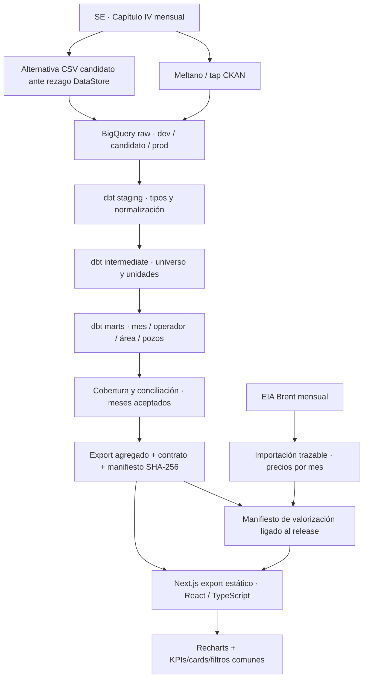

# Arquitectura — Vaca Muerta en Datos

Esta arquitectura separa la obtención de datos, su semántica analítica y la presentación. El frontend consume un snapshot agregado validado; no consulta credenciales ni tablas raw desde el browser. [README](../README.md) presenta el producto y [ADRs](adrs/README.md) explican las decisiones.

## Flujo implementado

El flujo tiene herramientas y controles reproducibles, pero no está encadenado automáticamente en producción de origen a publicación. La actualización candidata más reciente se operó explícitamente y dejó auditoría de sus etapas.

## Capas y contratos

| Capa | Contrato / responsabilidad | Justificación |
| --- | --- | --- |
| Fuente | Declaraciones oficiales pozo–mes; revisables | Conservar origen público y trazabilidad sin fingir tiempo real |
| Extracción | Meltano/Singer y tap CKAN propio; recurso y año explícitos | Código versionado y relectura anual para rectificativas |
| Raw BigQuery | Fidelidad al source; ambientes aislados | Separar investigación, candidato y producción |
| dbt staging/intermediate | Tipos, claves, recorte y conversiones | Semántica única antes de agregar |
| Marts | Agregados por mes, operador y área; pozos únicos por fluido | El producto usa definiciones verificables y granos estables |
| Gate y export | Aceptación de períodos, conciliación, contrato y hashes | Separar dato existente de dato apto para revisión/publicación |
| Precios | EIA Brent por mes y vínculo con release | Cada comparación usa su precio histórico; precios no bloquean volumen físico |
| Frontend | Next.js 16, React 19, TypeScript 7, Recharts 3 | Export estático, componentes reutilizables y navegación persistente |

La configuración raw Meltano usa partición mensual de `_sdc_batched_at`, no de `periodo`; producción se agrupa físicamente por `empresa`, `idpozo`, `cuenca`. La fecha de negocio se normaliza en dbt. Particionar por fecha de carga no elimina por sí solo el costo de una consulta histórica de períodos: deben revisarse predicados y bytes escaneados. Detalle de datasets/IAM: [guía dbt](../transform/README.md), [evidencia Hito 2](../transform/docs/hito-2-bq-iam.md).

El mart de tasa histórica `fct_production_rate` conserva el contrato de una fila para el último mes raw. **No define el corte de publicación actual**: el candidato acepta agosto de 2026 y excluye septiembre parcial mediante sus gates y marts de publicación. Ver [auditoría](evidence/data-valuation/README.md).

## Modelo de negocio

El universo de producto filtra `formacion = 'vaca muerta'` y `tipo_de_recurso = 'NO CONVENCIONAL'`. No representa toda la cuenca. El factor de petróleo es m³ × 6,28981077; gas se presenta en MMm³. Tasa = volumen del mes / días calendario.

Los pozos productivos tienen producción positiva del fluido en cada mes. Su promedio por pozo y día calendario es una razón entre agregados; no prueba días efectivos, declinación individual, nuevos pozos ni salidas del padrón. Adjunto IV es una fuente separada para fracturas/completaciones; no se fuerza su unión con producción si la relación no está confirmada.

La estimación monetaria de petróleo es volumen × Brent mensual, sin deducciones comerciales ni de costos. Gas no tiene una referencia nacional/conversión energética validada para el corte actual y queda sin USD. No rellenar precios ni aplicar el precio actual a toda la historia.

## Contrato de presentación

`apps/web/lib/contract.ts` valida release, cobertura y manifiesto. Los artefactos `release.json`, `manifest.json`, `prices.json` y `valuation-manifest.json` vinculan snapshot y precios. La aprobación de publicación es un estado separado; sin aprobación válida la app muestra Preliminar.

`dashboard-components.tsx` y CSS compartido definen el sistema de KPIs, cards, gráficos, ranking y filtros. Recharts implementa las visualizaciones del frontend; ver [ADR 0003](adrs/0003-resumen-ui.md). Todas las pestañas conservan producto/período/modo/comparación en URL, junto con detalle de entidad; idioma y tema permanecen como preferencias. Azul petróleo, violeta gas y ámbar económico tienen significado estable entre vistas.

## Orquestación y freshness

La extracción usa [.github/workflows/extract-cap4.yml](../.github/workflows/extract-cap4.yml): cron mensual día 5, 06:00 UTC. El default programado es `dev`, con el recurso 2025 configurado. La carga anual requiere `ALLOW_FULL_YEAR_LOAD=true`; sin la variable sale antes de Meltano/BigQuery. Esto es configuración declarada, no prueba de que un runner haya consumido todos los meses recientes.

La reemisión limpia el año/sandbox antes del append: dev utiliza TRUNCATE; prod, DELETE del año. El dispatch permite seleccionar recurso, ambiente y reemisión. Un re-run append sin limpieza puede duplicar datos.

[dbt-transform.yml](../.github/workflows/dbt-transform.yml) valida dependencias y parse. No orquesta un build del warehouse después de extracción ni exportación, aprobación y deploy. Precios/exportación requieren pasos explícitos. No hay SLA automático demostrado de extremo a extremo.

El objetivo de freshness es ingestar dentro de siete días de publicación oficial; sigue siendo una meta sin enforcement/alerta automática implementada. Medir por separado: mes de producción, modificación del recurso, extracción, carga, generación de snapshot y publicación. Una fuente DataStore atrasada puede tener una ejecución reciente: la auditoría de octubre encontró agosto en CSV y sólo julio en DataStore. La cobertura determina el corte, no el reloj del job.

## Seguridad, operación y próximos cierres

Credenciales sólo en entorno/secret manager; nunca en Git o cliente. BigQuery separa roles de carga y transformación y ambientes candidatos; promoción es deliberada. El costo depende de tamaño/reemisiones/queries y no se garantiza un costo cero.

Antes de operar como servicio de producción falta cerrar recurso vigente y monitoreo, encadenar extracción → dbt build/tests → gates → export, definir responsables de alertas y promover sólo con aprobación. El hosting sigue pendiente de decisión autorizada. Estos pasos operativos no se sustituyen con el build local o las capturas UI.

## Cierre de la capa de precios

El flujo EIA → importador → artefacto → browser describe la entrega actual. La valoración principal debe migrar a ingesta de precios en BigQuery, modelos dbt de referencia y valorización, y export aceptado; el frontend presenta resultados y contexto. Seeds para catálogos y respaldo histórico, no cotizaciones cambiantes como mecanismo permanente. [ADR 0005](adrs/0005-pricing-layer.md).

El [linaje dbt derivado de manifest](lineage/README.md) cubre modelos presentes en este árbol, no los marts candidatos de publicación pendientes en PRs de datos. Es una vista técnica diferente de la arquitectura completa.

### Corrección de recarga dev preparada

El run de extracción del 5 de octubre falló con 403 billingNotEnabled: TRUNCATE no está permitido en BigQuery sandbox. El script de preparación ya soporta recreación DROP/CREATE con el esquema y layout declarados. Esta rama reemplaza TRUNCATE por esa ruta sólo para dev. Prod conserva su DELETE anual y exige un proyecto/estrategia compatibles; no se habilitó facturación ni se ejecutó ninguna recarga. El último candidato publicable se conserva aunque una extracción falle.
