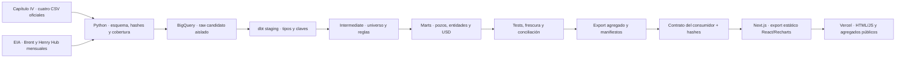

# Arquitectura — Vaca Muerta en Datos

La arquitectura separa fuente, semántica analítica y presentación. Python obtiene snapshots oficiales; BigQuery conserva datos aislados y dbt construye reglas y agregados verificables. El frontend consume agregados verificados y se publica como export estático en [Vercel](vercel.md), sin servidor de consultas, credenciales cloud ni lecturas raw desde el browser. La demo publicada conserva el estado preliminar del snapshot; publicación de la interfaz y aprobación de nuevos datos son decisiones distintas. [Producto y preguntas](../README.md), [decisiones](adrs/README.md) y [linaje real](lineage/README.md).

## Recorrido implementado

El CLI encadena transformación histórica, export y validación del contrato frontend. GitHub tiene preparación pública antes de WIF, identidades de carga/dbt separadas y tests/build del consumidor; su calendario permanece desactivado. La promoción pública es una decisión independiente, no una etapa implícita de construcción.

## Capas y motivos

| Capa | Implementación | Motivo |
| --- | --- | --- |
| Fuente | Declaraciones oficiales pozo × mes y cotizaciones EIA | Datos públicos revisables, sin inferir telemetría ni ingresos |
| Extracción | Python, CSV oficiales → Parquet tipado y HTML EIA | CSV oficial mostró más cobertura que DataStore; controlar rectificativas y cambios de esquema |
| Raw | BigQuery candidato aislado, partición por ingesta y clustering de producción | Fidelidad al source y separación de permisos; carga atómica por tabla |
| Staging | Tipos, claves, nombres y filtro VM no convencional | Resolver formato de origen antes de reglas de negocio |
| Intermediate | Clave pozo × mes y días calendario | Una sola definición evita filtros/conversiones distintos entre marts |
| Marts | Grano pozo × mes, dimensiones y agregados | Reglas auditables de pozos únicos, tasas, comparaciones exactas y YTD |
| Precios | Brent/Henry Hub en raw y dbt de valorización | Cotizaciones cambiantes no se mantienen como seeds; seeds para catálogos estables |
| Export | fct_dashboard_month + cotizaciones de la misma carga | Evitar aritmética monetaria duplicada y ligar fuente, build y consumidor |
| UI | Next.js 16, React 19, TypeScript 7, Recharts 3 y MapLibre | Export estático en Vercel, componentes/filtros comunes y mapa sin secretos cloud |
| Gates | Python, dbt, contrato Node y tests/build frontend | Una falla bloquea el siguiente paso; aprobación/publish separado |

Raw se particiona por `_sdc_batched_at`, no por el mes de producción: particionar marts históricos por `periodo` en el sandbox de 60 días podía eliminar datos recién construidos. Los hechos por pozo, operador y área y sus dimensiones usan clustering por sus identificadores; los marts de publicación y valorización no lo declaran. No se atribuye un beneficio de clustering a todas las tablas. Las métricas de performance registran bytes, tiempos y slot-ms reales; una vista CREATE con cero bytes no garantiza costo nulo de sus consultas. [Calidad y rendimiento](../transform/docs/quality-and-performance.md).

Staging puede alimentar directamente un mart: intermediate se usa cuando hay transformación reutilizable que separar. Aquí `stg_monthly_reference_price` valida referencias a grano producto × mes; `fct_reference_valuation_month` las cruza con producción y calcula valores a grano pozo × mes. Esa dependencia directa es intencional.

## Semántica del producto

Universo: `formacion = 'vaca muerta'` y `tipo_de_recurso = 'NO CONVENCIONAL'`, no toda la Cuenca Neuquina. Corte aceptado fijo enero 2023–agosto 2026; septiembre parcial queda fuera. Petróleo m³ × 6,28981077 → bbl; gas miles de m³ → MMm³. Tasa = volumen / días calendario.

Pozos productivos = IDs únicos con volumen positivo del fluido en el mes; los conteos petróleo/gas no se suman. Cambio neto es diferencia de conteos, no altas/bajas. Promedio diario por pozo no mide días efectivos, declinación de pozos comparables o eficiencia. No se infiere relación operador–área contemporánea desde agregados marginales; completaciones están fuera de esta entrega.

USD es estimación de referencia calculada por dbt: Brent mensual USD/bbl para petróleo; Henry Hub mensual USD/MMBtu para gas. Gas usa escenario EIA de 1.036 BTU/pie³ (0,03658599472346218 MMBtu/m³), no calorificidad medida de Vaca Muerta. No son ingresos, márgenes o precios realizados. Faltantes → NULL, sin relleno; base cero → porcentaje NULL; YTD sólo con calendario completo.

El mart persiste fluido × dimensión × ID × mes. Los ceros explícitos de entidades ausentes pertenecen a meses de cuenca aceptados; huecos fuera de cobertura siguen sin dato. “Áreas reportadas” cuenta registros actuales, no todo el catálogo histórico. PCN/PLU → Pluspetrol es el único agrupamiento comercial explícito; se conserva procedencia legal y no se reatribuye historia de vendedores adquiridos.

## Contrato frontend y seguridad

`release.json`, `manifest.json`, `prices.json` y `valuation-manifest.json` forman un bundle con SHA-256. `check_snapshot.mjs` utiliza los contratos del consumidor antes de que CI lo copie a su checkout temporal. `publication_approved=false`; sin aprobación independiente válida la app muestra Preliminar.

KPIs, cards, barras y filtros compartidos mantienen identidad visual: petróleo azul, gas violeta, dinero ámbar, variación verde/rojo. ES/EN, tema y contexto de producto/período/modo/comparación se conservan al navegar y recargar; detalles tienen deep links. Resumen conserva la base aprobada.

WIF/ADC sólo en el entorno, sin claves en Git ni cliente. SA de extracción escribe raw candidato; SA dbt lee raw y construye staging/intermediate/marts candidatos. Se mantienen restricciones de repo, main, workflow y ambientes. CI conserva sólo JSON reducidos, sin raw, perfiles, logs de conexiones, manifest dbt completo ni builds. No hay push, deploy o cambios IAM en el pipeline.

## Frecuencia, freshness y aceptación

La frecuencia de datos es mensual. Cron preparado día 5 a las 03:00 Argentina; `DATA_PIPELINE_ENABLED=false`. No se asume que la fuente publique ese día ni que el mayor mes disponible sea completo.

Los gates distinguen mes de negocio, recuperación real, ingesta y generación del snapshot. Frescura operativa máxima siete días; warning dbt a cinco días también detiene el CLI. No se rejuvenecen fuentes retenidas. Recuperación reciente no equivale a frescura económica ni cobertura: ambas se verifican aparte.

Cargas aisladas atómicas por tabla, no transacción conjunta producción/precios. El bundle se escribe en staging temporal y se mueve completo; un fallo no modifica el snapshot del repo. [Recorrido ejecutable](../pipeline/CLI.md) y [evidencia de integración](archive/evidence/orchestration-export/README.md).

El recorrido histórico de GitHub/WIF está [validado](evidence/github-actions/README.md); esa evidencia no demuestra disponibilidad actual de la fuente. La [demo está desplegada en Vercel](vercel.md), sin funciones ni warehouse durante la navegación. La extracción y el monitor están pausados (`DATA_PIPELINE_ENABLED=false`, `SOURCE_MONITOR_ENABLED=false`) por fallas de conectividad de los runners con Energía. No se habilitó facturación. Antes de reactivar la actualización desatendida se debe resolver ese acceso, validar una corrida completa y definir atención a fallos y promoción del nuevo snapshot. El deploy de la interfaz no ejecuta la ingesta.

La validación manual del workflow de datos está permitida únicamente en `main`, independientemente del opt-in del calendario. `DATA_PIPELINE_ENABLED=false` mantiene el cron desactivado; `workflow_dispatch` ejecuta una corrida puntual con los mismos permisos y gates.

El [monitor](../pipeline/MONITOR.md) observa producción/precios sin warehouse ni WIF. Separa estado observado de datos aceptados, conserva fingerprints agregados y avisa mediante Issues deduplicadas. Cadencia configurada diaria, lectura histórica completa semanal y al finalizar ingesta; el calendario permanece pausado con `SOURCE_MONITOR_ENABLED=false`. Señales de cobertura/estabilidad habilitan revisión; no prueban cierre oficial ni publican snapshots.

La ingesta histórica usa CSV → Parquet tipado; la entrega frontend mantiene el JSON canónico y genera overview/detalles gzip vinculados al manifiesto. Staging candidato es tabla para reutilizar deduplicación y evitar escaneos repetidos de raw. Ver [contrato de rendimiento](../specs/021-performance-optimization.md).

## Consultas, entrega y evidencia de rendimiento

La navegación ejecuta transformaciones sobre agregados públicos en memoria; no genera consultas BigQuery ni requests por fila de ranking. El export warehouse realiza dos consultas de datos por bundle: el mart completo de publicación y las cotizaciones de la carga vinculada. Los gates de linaje/freshness agregan sus propios jobs; no deben confundirse con esas dos lecturas ni con un patrón N+1 por operador o área.

La entrega divide el snapshot en overview y cuatro detalles por fluido/dimensión. Los módulos de pestaña y el mapa se cargan diferidos; los detalles se reutilizan por versión para evitar descargar por cada cambio de período. Los blobs gzip se verifican antes de descomprimir y no deben recibir un segundo `Content-Encoding: gzip`. El manifiesto permite ligar una versión sin mezclar datos de builds distintos. La política HTTP efectiva depende del host; no se afirma cache inmutable a partir de un nombre con hash.

El reporte histórico del 13/10 registra 105,83 s, 1,59 GiB facturables reportados y 554.443 slot-ms para 106 nodos dbt. El nodo de mayor pared fue `fct_reference_valuation_entity_month` (17,10 s); el de mayor uso de cómputo fue `fct_dashboard_month` (401.272 slot-ms). Son candidatos para medir, no prueba de una regresión ni latencia del dashboard. No se ejecutaron nuevas queries cloud en la revisión del 20/10. [Auditoría, hallazgos y límites](archive/evidence/share-readiness/architecture-audit.md).

## Nueva ingesta Singer candidata

[Meltano](../extraction/MELTANO.md) conecta el tap Capítulo IV con el target BigQuery de Blueprint mediante load jobs, en tablas aisladas que expiran. No promueve el raw canónico ni ejecuta dbt/export. La operación remota permanece pendiente de acceso a la fuente; [ADR 0008](adrs/0008-singer-bigquery-sandbox.md).
