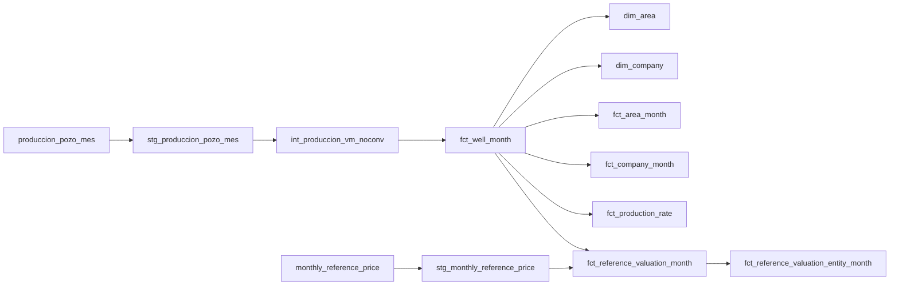

# Linaje del candidato ejecutado

Generado desde las dependencias del manifest de la corrida real: únicamente los 11 modelos construidos y sus fuentes directas. No contiene metadatos de conexión ni incluye tests/macros. No representa todavía publicación histórica del dashboard.

