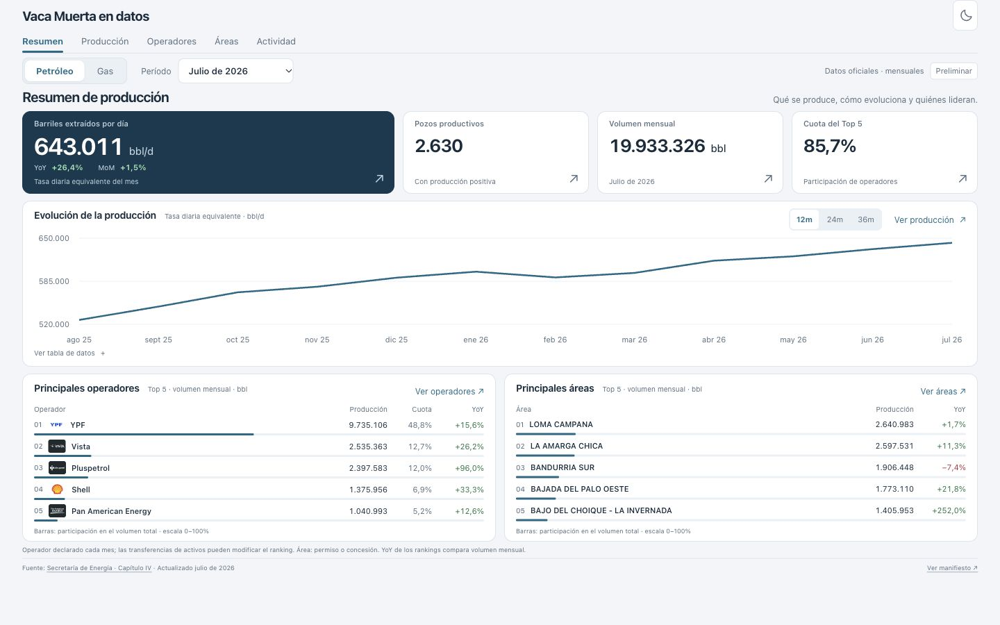
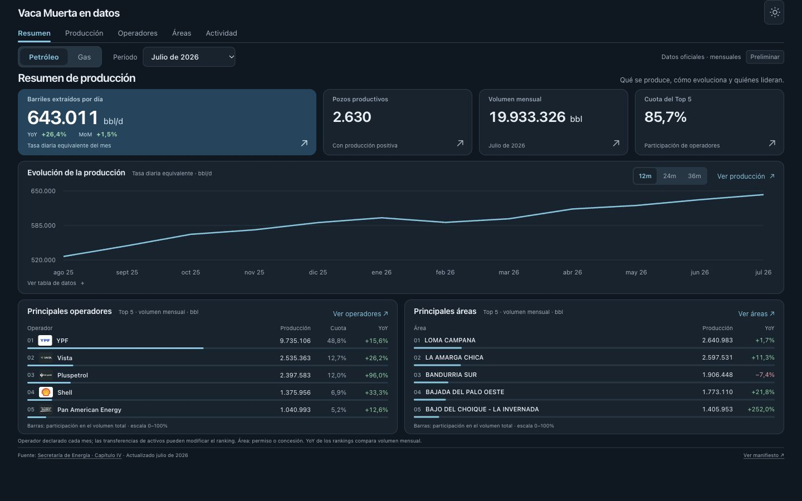
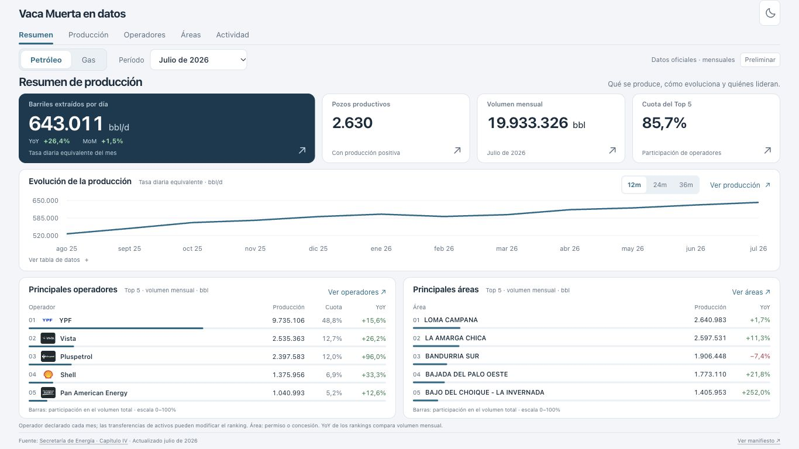
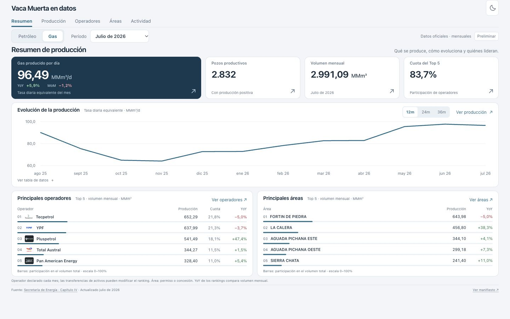
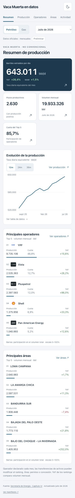
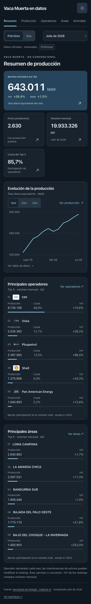

# Evidencia de revisión — Resumen

Fecha: 2026-10-09. Rama: feat/resumen-analytics-ui. Base GitHub: main (sin frontend); base funcional importada: entrega local del 6 de octubre. Skill analytics-ui: ZIP adjunto, SKILL.md y component-patterns.md leídos. Harness sin cambios.

## Resultado

Solo Resumen: producción diaria con YoY/MoM en la card principal; pozos productivos, volumen mensual y cuota Top 5 como KPIs secundarios; evolución a todo el ancho; Top 5 operadores con logos/producción/cuota/YoY y Top 5 áreas con producción/YoY. Verde positivo, rojo negativo por corrección expresa del usuario. Datos, cálculos, unidades y fuentes conservados. Navegación hacia destinos futuros sin drill-down implementado.

## Checks ejecutados

- TypeScript: correcto.
- Tests de contrato y navegación: 8/8 correctos.
- Build estático Next.js: correcto.
- Copias exactas de contract.ts, operators.ts, release.json y manifest.json verificadas por bytes y SHA-256; ver baseline-hashes.json.
- Revisión UI en navegador integrado: los cuatro KPIs de petróleo y gas coinciden con el snapshot; ambas listas Top 5 y las diez escalas proporcionales coinciden con volumen/total. Los cinco logos de cada fluido cargan.
- Desktop 1440×900: documento 1440×900; notebook 1366×768: documento 1366×768. No hay scroll horizontal ni vertical en Resumen cerrado. También se comprobó el primer período sin comparadores en notebook, sin scroll. Expandir la tabla permite scroll intencionalmente.
- Mobile 390×844 y 320×740: sin desbordamiento horizontal. Apilado y scroll vertical para preservar legibilidad. Capturas revisadas en claro/oscuro.
- Filtros petróleo/gas y mes, rango 36m y fallback 1m del período inicial, persistencia tras reload, tabla accesible, atrás/adelante, destinos de operador/área y tabs Producción/Actividad revisados. Los destinos muestran Próximamente y mantienen filtros. El título de Producción/Actividad no hereda entidades ajenas.

## Límite de la validación

El runner Playwright no pudo iniciar Chromium: macOS denegó el registro MachPortRendezvousServer (Permission denied). Los escenarios UI se revisaron con el navegador integrado mediante CUA y lectura del DOM. La suite de navegador final (8 casos, incluyendo axe) queda disponible para ejecutar en un entorno que permita arrancar Chromium; NO se declara como pasada. La revisión visual/funcional no equivale a una auditoría automatizada completa de accesibilidad. No se ejecutaron dbt/warehouse porque no se modificaron.

El snapshot sigue candidato/preliminar, con dependencia de los marts/export de #27, #29 y #31; no se promovió ni inventó aprobación. PR de revisión, sin merge ni deploy.

## Capturas

ui-checks.json contiene los valores y dimensiones observados.
