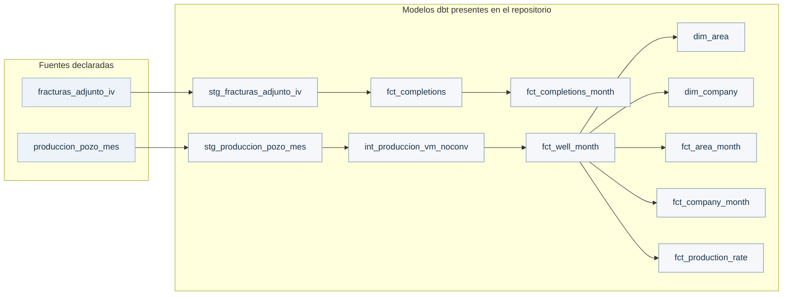

# Linaje dbt — Vaca Muerta en Datos

Este diagrama deriva del `parent_map` del manifest generado por dbt el **9 de octubre de 2026, 19:17:13 UTC** (dbt **1.12.5**, schema manifest v12). Se limita a las fuentes y modelos presentes en el código actual; cada dependencia se contrastó con las llamadas literales `ref()` y `source()` del SQL.

No es un gráfico dibujado a partir de la arquitectura propuesta ni una nueva ejecución de `dbt docs generate`, `dbt parse` o `dbt build`. El artefacto retenido incluía modelos candidatos/geográficos ausentes del checkout actual; no se presentan como implementación disponible. Se excluyen tests, macros y nodos de paquetes para facilitar lectura.

El mart de tasa adopta el nombre técnico `fct_production_rate` mediante la normalización explícita del identificador previo, sin cambiar sus dependencias. Esto no prueba una migración de relaciones en BigQuery ni una ejecución reciente de estos modelos.

## Diagrama

## Trazabilidad

- Código contrastado: commit `0316dd51cf3e25802b714e1294a08e786a90994b`.
- Manifest fuente SHA-256: `bfa3a0bce6e3a6d2d5138e18dc02226eb248c7656ae3e42b08224b460c4ff536`.
- 11 modelos, 2 fuentes lógicas y 11 relaciones verificadas.
- Sólo se exportan nombres lógicos y dependencias; no se copian el manifest completo, credenciales ni conexiones físicas.
